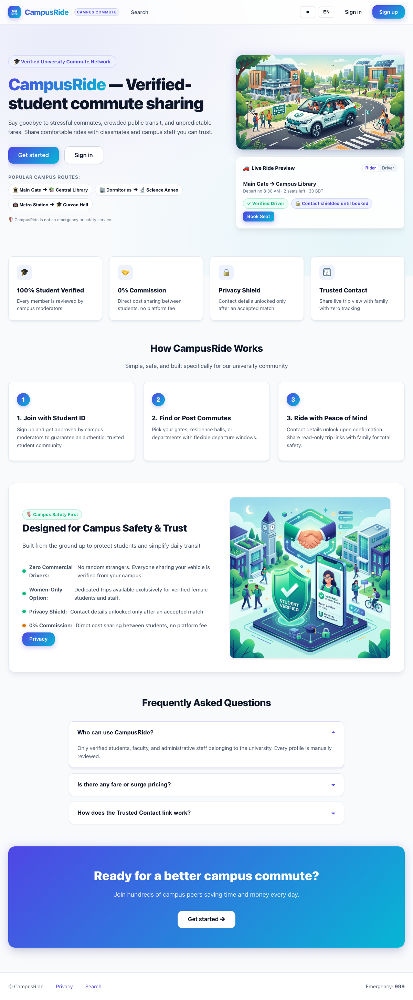
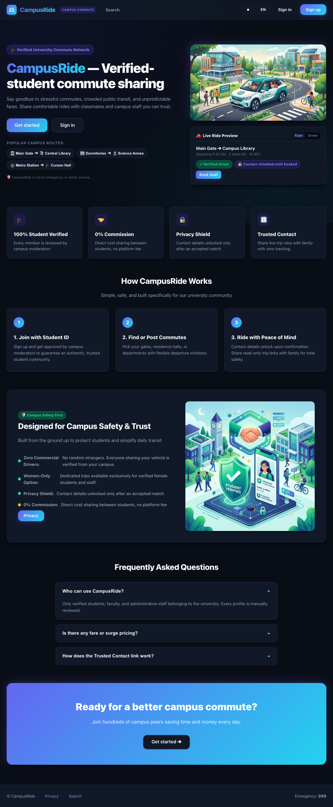
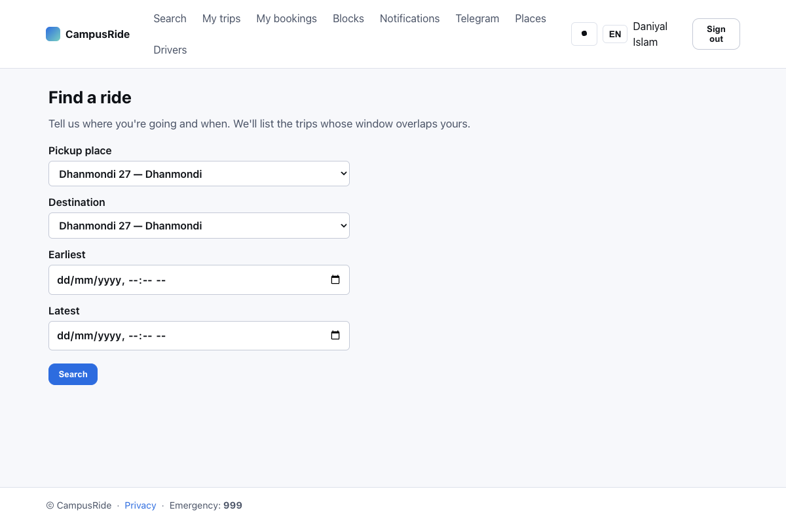
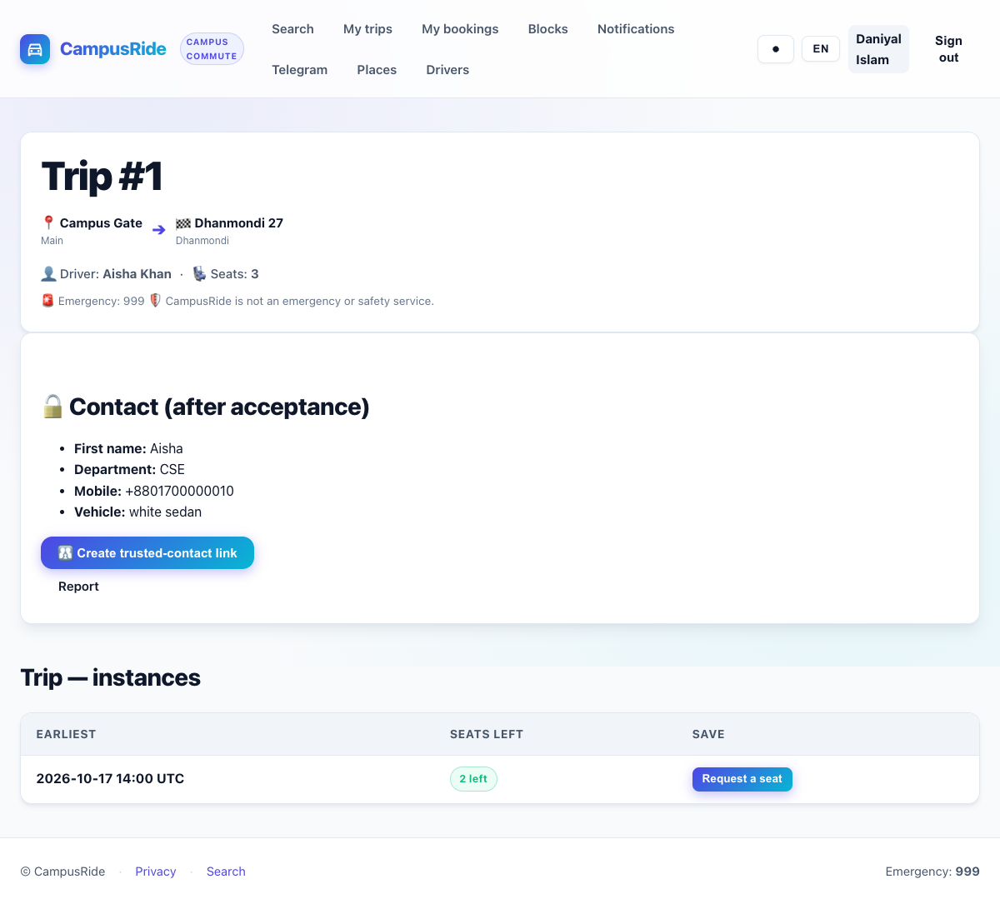
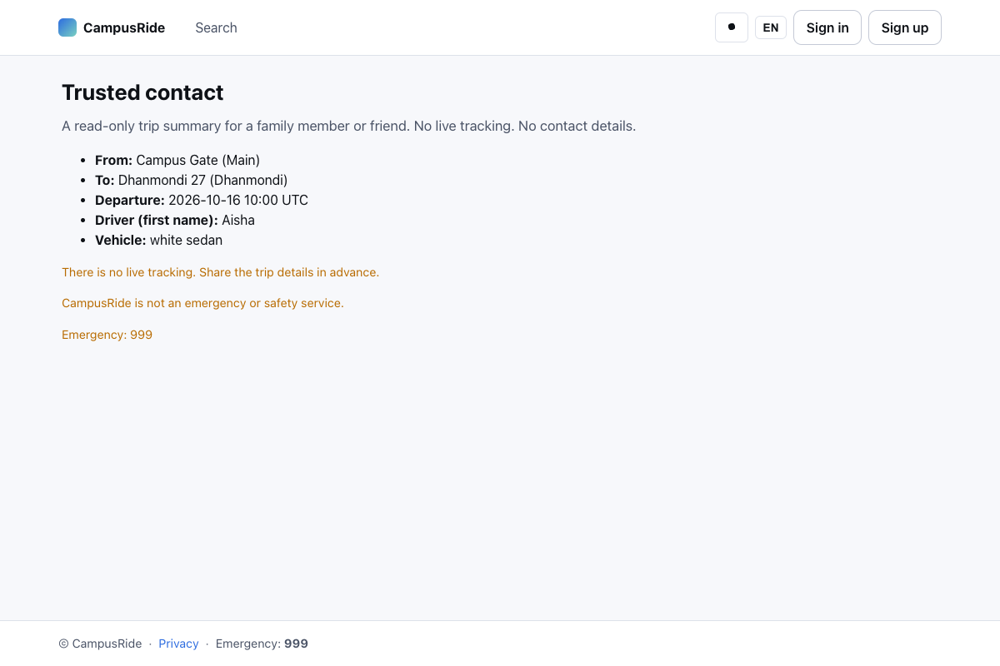
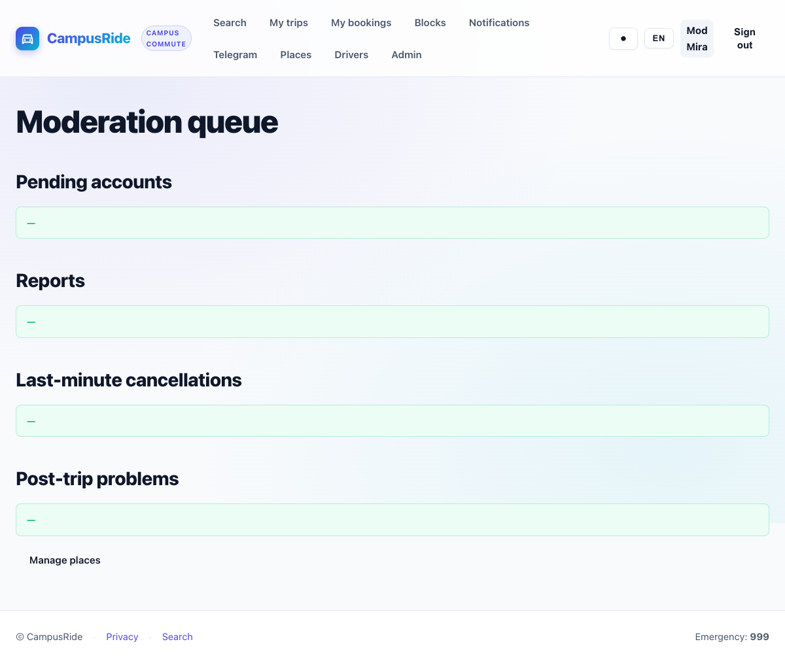
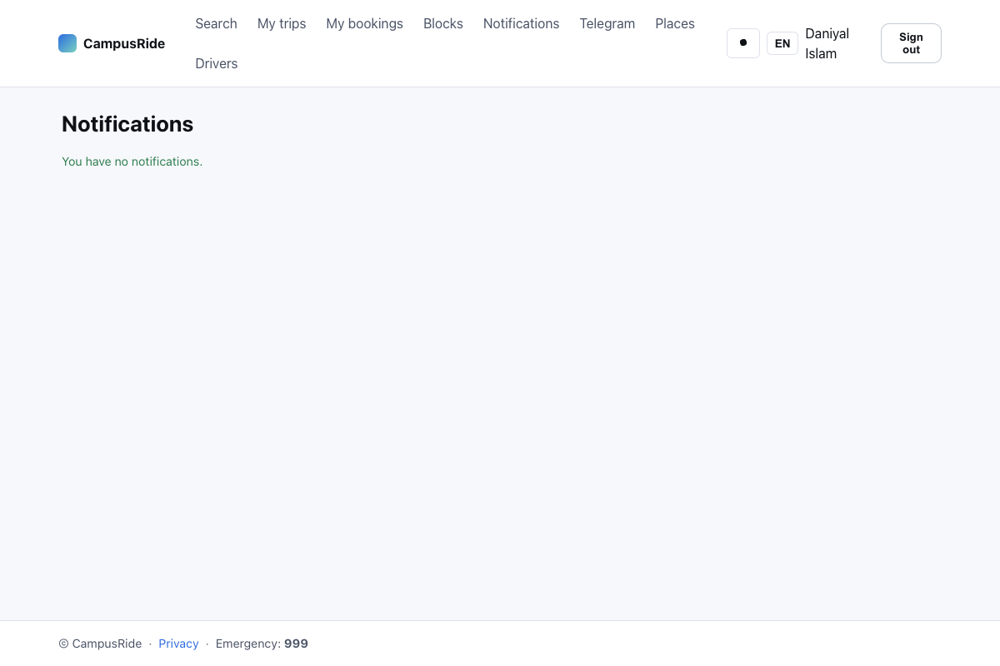

# CampusRide

**Verified-student commute sharing for a single campus.**

| ☀️ Light Theme | 🌙 Obsidian Dark Theme |
|:---:|:---:|
| [](docs/screenshots/01-home.png) | [](docs/screenshots/01-home-dark.png) |

CampusRide is a small FastAPI service that lets students offer and
find shared rides between named pickup points. Every account is
manually approved by a moderator. Phone numbers, vehicle plates and
trip history are private by default and only revealed after a
booking is accepted. A read-only **trusted contact link** can be
shared with a family member so they can see the route, time,
driver first name and vehicle description without signing in.

The platform is intentionally small. It is one web process, one
worker process, and one Postgres database. No Redis, no S3, no CDN,
no message queue. Anything that would pull those in is out of
scope — see [`SCOPE.md`](./SCOPE.md).

---

## Features at a glance

- **F1 Accounts** with moderator approval (Argon2 passwords, signed
  session cookies, CSRF on every state-changing form, in-database
  rate limit, 10 single-use recovery codes shown once).
- **F2 Places** managed by moderators (gates, halls, departments,
  common pickup points, named neighbourhoods).
- **F3 Driver verification** by a moderator after an in-person
  check, with a vehicle description and an optional plate.
- **F4 Trips** with a 30-minute departure window, optional weekly
  recurrence, and a rolling 14-day horizon of trip instances.
- **F5 Matching** that returns compatible trip instances for a
  rider's search window, ranked deterministically. Women-only
  trips and members when `WOMEN_ONLY_TRIPS=true`.
- **F6 Seat booking** with no overbooking under concurrency
  (proven on Postgres with a 20-way race test).
- **F7 Reveal and trusted contact** — phone numbers and plates stay
  private until both sides accept. The trusted-contact public page
  exposes only route, time, driver first name and vehicle
  description.
- **F8 Trust and moderation** — block users, report users or
  trips, post-trip "all good / had a problem" check, every
  moderator action logged in `audit_logs`.
- **F9 Notifications** — in-app with unread count, optional
  Telegram via a webhook. A database-backed job queue with a
  worker that uses a Postgres advisory lock.
- **F10 Privacy and operations** — data minimisation,
  `app purge` retention sweep, delete-my-data, EN + BN UI,
  hardened `/health` with worker heartbeat, CSP without inline
  scripts, idempotent demo seed.

---

## Quickstart (developer machine)

```bash
# 1. Clone and enter.
git clone https://github.com/.../CampusRide
cd CampusRide

# 2. Create a venv and install pinned deps.
make install          # python3.12 -m venv .venv && pip install -r requirements.txt

# 3. Run the app against SQLite.
make run              # migrates, then uvicorn on :8000

# 4. In a second terminal, run the tests.
make test             # full SQLite suite (~10 s)
```

Visit <http://localhost:8000>. The home page renders in English;
toggle to Bangla with the language switcher. Sign up to see the
pending state; approve yourself with the seed helper:

```bash
.venv/bin/python -m app.seed          # idempotent: 1 mod, 3 drivers, 3 riders, 6 places, 3 trips
.venv/bin/python -m app.cli create-moderator \
    --mobile 01700000001 \
    --password 'choose-a-strong-password' \
    --full-name "Mod Mira" \
    --department "Staff" \
    --batch "N/A"
```

The full operating manual is in [`DEPLOY.md`](./DEPLOY.md); the
moderation guide is in [`MODERATOR_GUIDE.md`](./MODERATOR_GUIDE.md);
the first-pilot runbook is in [`PILOT.md`](./PILOT.md).

---

## Deploying

```bash
# 1. Set the production environment.
export APP_ENV=production
export SECRET_KEY="$(openssl rand -base64 48)"
export DATABASE_URL="postgresql+psycopg://campusride:STRONG@db:5432/campusride"

# 2. Build and start the stack.
docker compose up --build -d

# 3. Migrate.
docker compose run --rm web python -m app.cli upgrade-db

# 4. Create the first moderator.
docker compose run --rm web python -m app.cli create-moderator \
    --mobile 01700000001 --password 'choose-a-strong-password' \
    --full-name "Mod Mira" --department "Staff" --batch "N/A"

# 5. Smoke test.
scripts/smoke_test.sh https://ride.campus.edu
```

See [`DEPLOY.md`](./DEPLOY.md) for multi-host scaling, the env var
table, reverse-proxy headers, the retention-purge cron, and the
hardening checklist.

---

## The fresh-clone test

```bash
scripts/fresh_clone_test.sh            # full: SQLite + Postgres
scripts/fresh_clone_test.sh --no-pg    # skip the Postgres stage
```

The script clones the repo into a throwaway work directory, builds
a venv, lints, runs `upgrade → downgrade → upgrade`, and runs the
full test suite against SQLite (215 tests). With Docker available,
it also spins up a throwaway `postgres:16-alpine` and runs the
Postgres-marked tests. It never mutates the source tree.

---

## Screenshots

> All screenshots are captured directly from the live application via Playwright (`scripts/capture_screenshots.py`) using seeded test data, and are stored in `docs/screenshots/`.

<!-- screenshot-grid:begin -->
| ☀️ CampusRide Homepage (Light Mode) | 🌙 Obsidian Night Theme (Dark Mode) |
|:---:|:---:|
| [](docs/screenshots/01-home.png) | [](docs/screenshots/01-home-dark.png) |
| **🔍 Find a Ride (Search & Quick Presets)** | **🎟️ Trip Booking & Contact Reveal** |
| [](docs/screenshots/02-search.png) | [](docs/screenshots/03-booking.png) |
| **🛡️ Read-Only Trusted Contact Link** | **⚖️ Moderator Approval Queue** |
| [](docs/screenshots/04-trusted.png) | [](docs/screenshots/05-queue.png) |
| **🔔 In-App Live Notifications** | |
| [](docs/screenshots/06-notifications.png) | |
<!-- screenshot-grid:end -->

See [`docs/screenshots/README.md`](docs/screenshots/README.md) for the full list, capture instructions, and what each shot demonstrates.

---

## Architecture

```
                ┌──────────┐
   browser ───▶ │  web     │ ──▶ Postgres
                │ (uvicorn)│      ▲
                └──────────┘      │
                                  │
                ┌──────────┐      │
                │  worker  │ ─────┘
                │ (loop)   │
                └──────────┘
```

- **`web`** — FastAPI/uvicorn on `:8000`. Optionally runs the
  worker in-process (`RUN_WORKER_IN_PROCESS=true`) for single-host
  pilots only.
- **`worker`** — the same container running `python -m app.worker`.
  On Postgres a session-level advisory lock guarantees that only
  one worker dispatches at a time, so horizontal scaling is safe.
- **`db`** — Postgres 16. Alembic owns the schema.

There is no Redis, no S3, no CDN, no message queue. This is the
entire stack.

---

## Project layout

```
app/
  main.py           # FastAPI factory, /health, security headers
  config.py         # pydantic-settings, runtime validators
  db.py             # engine + session factory
  cli.py            # upgrade-db, downgrade-db, create-moderator, purge, seed
  purge.py          # (M9) retention sweep
  seed.py           # (M9) idempotent demo seed
  auth.py           # sessions, current_user, require_moderator
  audit.py          # write() — every moderator action lands here
  jobs.py           # claim_next / mark_done / mark_failed
  worker.py         # heartbeat, dispatch loop, advisory lock
  routes/           # FastAPI routers, one per area
  models/           # SQLModel tables
  templates/        # Jinja2, vendored HTMX-friendly, no inline scripts
  static/           # CSS, vendored HTMX, app.js
  i18n/             # en.json, bn.json, identical keys
alembic/            # 0001_init, 0002_trusted_contact_links
tests/              # 215 tests, SQLite by default
scripts/            # smoke_test.sh, fresh_clone_test.sh, capture_screenshots.py
```

---

## Development

```bash
make install        # venv + pinned deps
make run            # migrate + uvicorn :8000
make test           # pytest -q
make lint           # ruff check .
make fmt            # ruff check --fix .
make upgrade-db     # alembic upgrade head
make downgrade-db   # alembic downgrade base
make compose-up     # docker compose up --build
make compose-down   # docker compose down -v
make smoke          # scripts/smoke_test.sh http://localhost:8000
```

CI runs `upgrade → downgrade → upgrade`, the full SQLite suite, and
the Postgres-marked tests on every push; see
`.github/workflows/ci.yml`.

---

## Internationalisation

Both dictionaries live in `app/i18n/en.json` and `app/i18n/bn.json`.
They have **identical keys** — the contract is enforced by
`tests/test_m9.py::test_supported_languages_have_identical_keys`.
Add a new string by editing both files in the same commit.

---

## License

See `LICENSE`.
